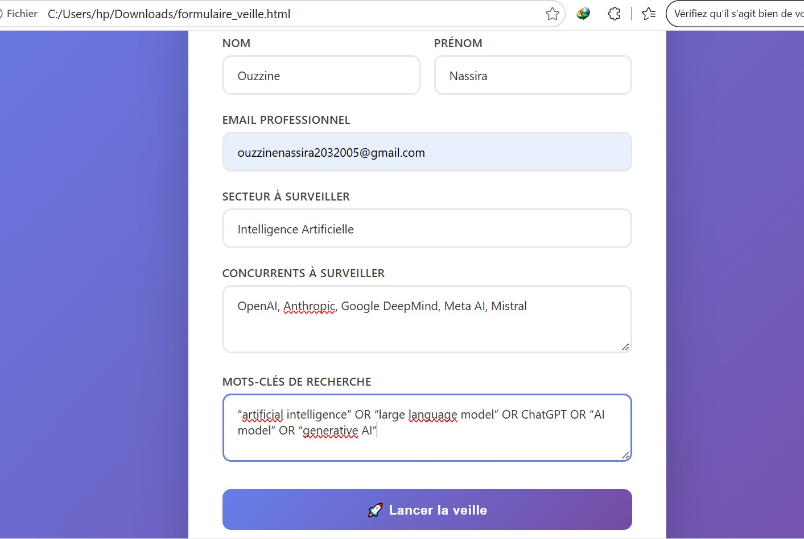
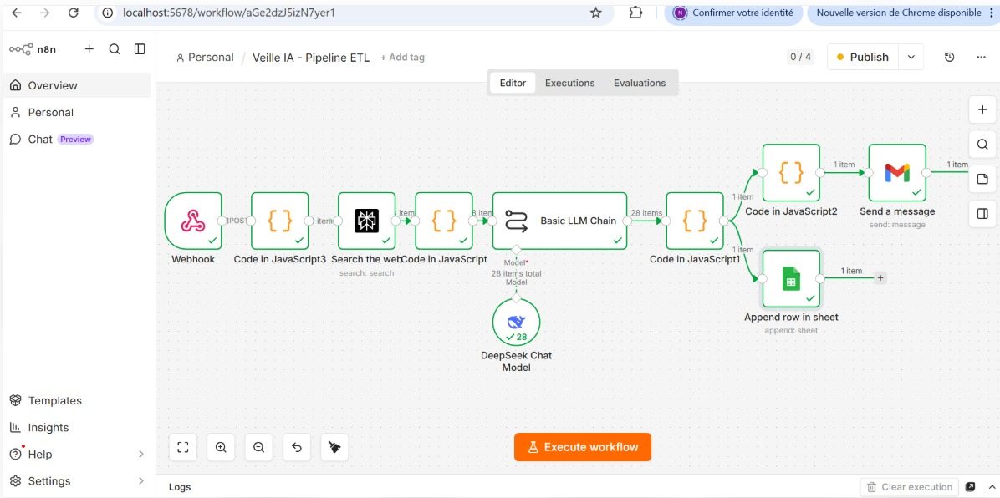
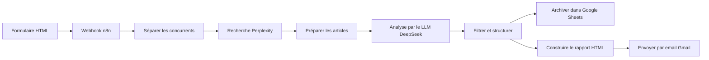

# Veille concurrentielle automatisée

Pipeline qui surveille des concurrents sur un secteur donné : un formulaire web
déclenche la recherche d'actualités récentes, leur analyse par un modèle de
langage, puis la restitution des résultats dans Google Sheets et par email.

> Projet réalisé pendant mon stage chez Value IT (juin – août 2026), publié
> avec l'accord de mon encadrant. Aucune donnée confidentielle de l'entreprise
> n'est incluse.
> Réalisé avec l'aide d'un assistant IA, puis testé et adapté par moi.

## Aperçu

## Architecture

## Fonctionnement

1. **Formulaire HTML** : nom, prénom, email professionnel, secteur à surveiller,
   concurrents (séparés par des virgules) et mots-clés de recherche.
2. **Webhook n8n** : le formulaire envoie une requête POST qui déclenche le
   workflow.
3. **Une recherche par concurrent** : l'API Perplexity cherche les actualités
   des dernières 24 heures (20 résultats maximum par concurrent).
4. **Analyse de chaque article** : le modèle DeepSeek répond en JSON : résumé
   (3 phrases maximum), catégorie (Produit, Prix, Marketing, Innovation ou
   Partenariat), concurrent concerné et note d'importance de 0 à 10. Le prompt
   impose de répondre en français et de ne rien inventer.
5. **Filtrage** : les articles sans pertinence (note 0 ou concurrent non
   identifié) sont écartés. S'il ne reste rien, une ligne « Aucune actualité
   pertinente » est produite.
6. **Restitution** : les résultats sont ajoutés dans Google Sheets, et un
   rapport HTML, groupé par concurrent avec un code couleur selon la note, est
   envoyé par email.

## Données produites (Google Sheets)

| Date | Nom | Secteur | Concurrent | Catégorie | Résumé | Importance | Email |
|------|-----|---------|------------|-----------|--------|------------|-------|

Un extrait est fourni dans `resultats_exemple.xlsx`.

## Résultats

Plus de 100 articles analysés lors des tests de juillet 2026 (version initiale
du workflow), sur trois secteurs : automobile, intelligence artificielle,
e-commerce. Une exécution dure environ 1 minute 15 secondes.

## Évolutions possibles

- Déclenchement programmé (le système est aujourd'hui lancé à la demande).
- Ajout des liens vers les sources dans le rapport et dans la feuille.

## Contenu du dépôt

- `index.html` : formulaire de saisie.
- `veille_pipeline.json` : workflow n8n exporté (identifiants et clés retirés).
- `resultats_exemple.xlsx` : extrait de résultats.
- `formulaire.jpeg`, `workflow_n8n.jpeg` : captures d'écran.

## Utilisation

1. Importer `veille_pipeline.json` dans n8n.
2. Sélectionner les identifiants : clé API Perplexity, clé API DeepSeek et
   connexion Google (Gmail et Sheets). Aucune clé n'est incluse dans ce dépôt.
3. Créer une feuille Google Sheets avec les colonnes du tableau ci-dessus (plus
   une colonne `isEmpty`) et la sélectionner dans le nœud « Archiver dans
   Google Sheets ».
4. Activer le workflow : le webhook écoute alors sur le chemin `/webhook/veille`.
5. Renseigner l'adresse complète du webhook dans `index.html` (fonction
   `fetch`), puis ouvrir le formulaire dans un navigateur.

## Stack

HTML · n8n · API Perplexity · DeepSeek · JavaScript · Gmail · Google Sheets
